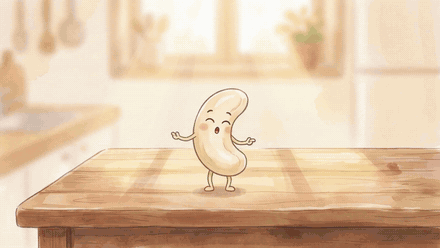
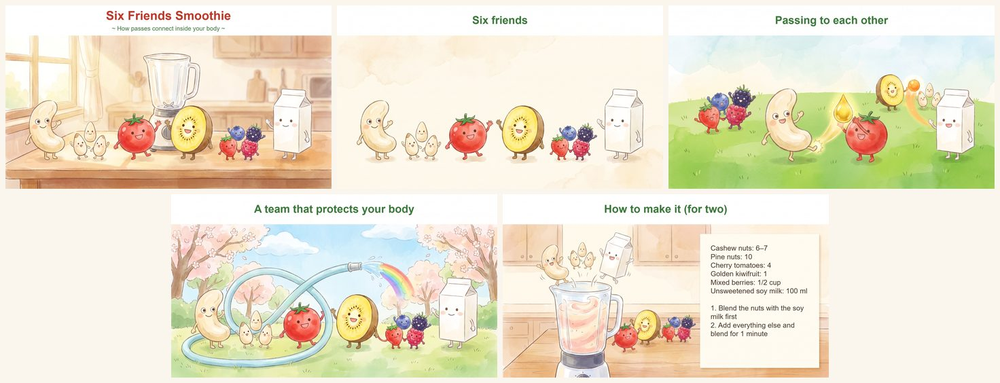

# Digital Kamishibai（デジタル紙芝居）

[English](README.md)

*ここで言うデジタル紙芝居は、**身近な人に向けて**作る紙芝居です。見せる相手は、自分の子どもでも、パートナーや友だちでも、教室のみんなや大人の仲間でもかまいません（家族では、やがて子ども自身が語り手になることもあります）。
昔の街頭紙芝居をデジタルにしたものとも違います。*

ここでは、絵を1枚ずつ見せながら声に出して語り、音楽も流します。
このプロジェクトには、次の2つがあります。

- **AI アシスタント（Claude・Codex・ChatGPT）に入れるスキル**: 紙芝居づくりを手伝います。話を聞き、一緒にプランを立て、
  作る人の言葉で台本を書き、事実を確かめ、練習につきあいます。
- **ルームプレイヤー**: 語り手が絵を送って音楽を鳴らすと、聞き手の端末にも同じ絵と音が届くウェブページです。
  同じ部屋でも、別々の家からでも使えます。

## 見本:「6人のなかまのスムージー」

5枚・約6分、小学生くらいの子ども向けです。毎朝スムージーを作っている人が、そのスムージーをお話にしました。
材料ひとつずつに得意技があり、いっしょに入るとサッカーのパスのように助け合う——というお話です。作ったその日に、家族の前で上演しました。

### 5分で試す

1. [six-friends-smoothie-ja.zip](https://github.com/digital-kamishibai/digital-kamishibai/releases/download/sample-six-friends-smoothie/six-friends-smoothie-ja.zip)
   （英語版は [six-friends-smoothie-en.zip](https://github.com/digital-kamishibai/digital-kamishibai/releases/download/sample-six-friends-smoothie/six-friends-smoothie-en.zip)）
   をダウンロードして、解凍します。
2. パソコンで **https://digitalkamishibai.org** を開き、*Narrate*（語る）を押して、解凍したフォルダを選びます。
3. スマホかもう1台のパソコンで同じアドレスを開き、*Listen*（聞く）を押して、6桁の合言葉を入れます。
   語り手の画面で、その端末の参加を認めます。
4. 語り手の画面の台本を声に出して読みながら、絵を送ります。聞き手の画面も同じ絵に変わります。

フォルダの中の `holes.md` には、作る人が自分のものに替える場所（**穴**）が6つ書いてあります——語り手と作り始めた理由、レシピ、音楽、エンディング動画、問いかけ、絵。
見本の作り手がそれぞれをどう埋めたかも書いてあります。

### 必要なもの

- ふだん使っている AI アシスタント（Claude・Codex・ChatGPT のどれか）
- Python と、Microsoft Edge か Google Chrome が入ったパソコン
- 絵は家族の写真や子どもの絵でかまいません。見本の絵は AI で作りましたが、必須ではありません。動画と音楽は無くてもかまいません
- 見本づくりにかかった時間は、プランを立ててからエンディング動画ができるまで、記録に残っている作業で約3時間です（すべて同じ日。レシピについて話を聞いたのはそれより前で、時間に入っていません）。
  段階ごとの流れは「[見本ができるまで](docs/how-the-sample-was-made.ja.md)」にあります

### 曲・動画と権利

**家族の前で楽しむ分には、CD から取り込んだ曲や自分で撮った動画を、好きに使ってかまわないと考えられています**（日本では私的使用の範囲とされています。国によって扱いは違い、これは法律の助言ではありません）。

- 配信サービスでダウンロードした曲や、DVD から取り出した映像のように、コピー防止を外さないと使えないものは、家の中でも避けておくと安心です
- 作品を配るとき、またはルームプレイヤーで家族の外の人へ届けるときは、権利の切れた曲を使い、動画は同梱せずリンクで案内するのが安心です
- 見本を元にした作品を配るときは、「Digital Kamishibai, by Fast Focus Technologies」と、変えたことを添えてください（見本の文章は CC BY 4.0 です）
- 家族が写った写真や動画を配るときは、写っている人に一声かけておきましょう

## なぜ「穴」なのか

お話そのものは借りてきてかまいません——科学の話、歴史の一場面、1冊の本。手作りの紙芝居で大事なのは、その中の**穴**です。
穴とは、作る人と聞く人にしか埋められない場所のこと——聞き手の質問、作る人自身のつまずき、今月家で流れている曲、自分たちの写真。
スキルは、まずその穴を探します。何も出てこなければ、無理に埋めずに空けたまま仕上げます。穴はどれも、埋めなくてかまいません。

スキルは押しつけもしません。誰かに参加を頼むことはなく、締切もありません。言葉はすべて作る人が決めます。

## スキルの入れ方

- **Claude Code**: セッションの中で
  `/plugin marketplace add digital-kamishibai/digital-kamishibai` → `/plugin install digital-kamishibai@digital-kamishibai`
- **Codex**: ターミナルで
  `codex plugin marketplace add digital-kamishibai/digital-kamishibai` → `codex plugin add digital-kamishibai@digital-kamishibai`
- **ChatGPT・Claude（claude.ai）**: `skills/digital-kamishibai/` のフォルダを zip にして、スキルとして追加します

くわしい手順と注意は [README（英語）](README.md#install-the-skill) にあります。

**見本を自分のものにする**: 解凍した見本を AI が読める作業フォルダに置き、スキルを呼んで、こう頼みます。

> six-friends-smoothie-ja を見本に、わが家の得意料理の紙芝居にしたい。

AI は見本とその穴を読んでから、どの料理か、誰が作っているか、なぜ伝えたいかを聞き、一緒にプランを立てはじめます。
チャットの AI（claude.ai・ChatGPT）で相談するなら、フォルダの中の `holes.md`・`script.md`・`plan.md` の3つのテキストだけを渡せば足ります（絵・音・動画は手元のフォルダに置いたままで大丈夫です）。

## 誰でも開けるアドレスでも安全な理由

- **作品がサーバーに送られることはありません。** 語り手のブラウザは、語り手のパソコンにある作品のフォルダを読みます。ページそのものにお話は入っていません
- **絵・音楽・動画・声は、語り手の端末から聞き手の端末へ直接届きます。** 公開しているサーバーは、端末どうしを引き合わせるだけです。
  直接つながらないとき（別々の家のネットワークどうしでよくあります）は、中継サーバーが暗号化したまま受け渡し、中身を残しません
- **入れるのは語り手だけです。** 聞き手は6桁の合言葉を入れたあと、語り手がその端末を入れるまで待ちます。守っているのは合言葉ではなく、語り手の承認です

## 質問と困ったとき

- **質問・アイデア・わが家の穴の埋め方**: [Discussions](https://github.com/digital-kamishibai/digital-kamishibai/discussions)
- **動かないとき**: [Issues](https://github.com/digital-kamishibai/digital-kamishibai/issues)。
  家族の名前・お話の中身・写真は書かずに、一般的な言葉で教えてください

日本語で書いてかまいません。小さなチームが空いた時間に続けているので、すべて読みますが、いつ返事ができるかはお約束できません。

## 運営とライセンス

Digital Kamishibai は、Fast Focus Technologies という、外部の出資を受けていない小さなチームが作り、続けています。
コードは MIT ライセンスで、作品はいつも作る人の手元のフォルダにあります。だから、このプロジェクトは誰でも引き継げます。

コードは MIT（[LICENSE](LICENSE)）、文書（スキルとその参考資料・テンプレート・見本）は CC BY 4.0（対象は [LICENSE-docs](LICENSE-docs)）、
`docs/images/` の画像は CC0 です。`player/vendor/` の外部のコードは、それぞれのライセンスに従います。
