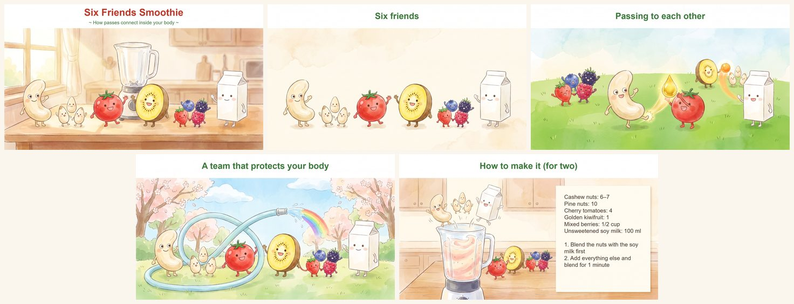

# Digital Kamishibai

[日本語](README.ja.md)

*Digital Kamishibai here is a picture-story show you make **for the people close to you** — your children, a partner,
friends, a class, or a group of adults. In a family, the children often take a turn as narrator in time.
It is not a lean-management task board, and not a digitized edition of traditional Japanese street kamishibai.*

A kamishibai is a story told aloud over a series of pictures, one picture at a time, usually with music.
This project gives you two things:

- **A skill for an AI assistant** (Claude, Codex or ChatGPT) that helps you make one: it interviews you, plans the
  show with you, writes the script in your words, checks the facts, and helps you practise.
- **A room player** — a web page where the narrator shows the pictures and plays the music, and listeners follow
  on their own devices, in the same room or in different houses.




*Six Friends Smoothie* — five slides, about six minutes, for children of primary-school age. Someone who makes a smoothie
every morning turned it into a story for their family: each ingredient has a special skill, and together they pass to
each other like players on a football team. It was performed for the family on the day it was made.

## Try a sample in five minutes

1. Download [six-friends-smoothie-en.zip](https://github.com/digital-kamishibai/digital-kamishibai/releases/download/sample-six-friends-smoothie/six-friends-smoothie-en.zip)
   (in Japanese: [six-friends-smoothie-ja.zip](https://github.com/digital-kamishibai/digital-kamishibai/releases/download/sample-six-friends-smoothie/six-friends-smoothie-ja.zip))
   and unzip it.
2. Open **https://digitalkamishibai.org** on a computer, press *Narrate* and choose the unzipped folder.
3. On a phone or a second computer, open the same address, press *Listen* and enter the six-digit code.
   Let the device in on the narrator's screen.
4. Read the story aloud from the narrator's screen and move through the slides. The listener's screen follows.

`holes.md` in the folder shows the places you replace with your own — the narrator and why they started, the
recipe, the music, the ending video, the one question, the pictures — and how the sample's maker filled them.

### What it takes

- An AI assistant you already use (Claude, Codex or ChatGPT), and a computer with Python and either Microsoft Edge
  or Google Chrome.
- Pictures can be your own photos or drawings. The sample's pictures were made with an AI, but that is not
  required. The ending video and the music are optional.
- The sample took about three hours of recorded work, all on one day, from the first plan to the finished ending video
  (the talk about the recipe came earlier and is not counted). See
  [How the sample was made](docs/how-the-sample-was-made.md) for each step.

### Music, videos and rights

**For showing to your family, songs copied from your own CDs and videos you took yourself are generally thought to be
fine to use as you like** (in Japan this counts as private use; it differs from country to country, and this is not
legal advice).

- Things you can use only by breaking their copy protection — tracks downloaded from a streaming service, video taken
  off a DVD — are safer left out, even at home.
- If you give the work out, or send it through the room player to people outside your family, it is safer to use music
  whose rights have expired, and to link to videos rather than include them.
- If you give out a work made from the sample, add "Digital Kamishibai, by Fast Focus Technologies" and say what you
  changed (the sample's text is under CC BY 4.0).
- If you give out photos or videos with your family in them, it is kind to ask the people in them first.

## Why

The story itself can be borrowed — a piece of science, a moment in history, a book. What makes a homemade
kamishibai work is the **holes** in it: the places only the maker and the listeners can fill. A listener's question,
the maker's own stumble, the songs playing in the house this month, the maker's own photos. The skill looks for those holes first.
If nothing comes, it leaves them empty rather than forcing them — every one of them is optional.

It never pushes, either: nobody is asked to take part, there are no deadlines, and the maker decides every word.

## Quick start

1. **Install the skill** in the AI you use (details below). Then say something like:

   > I'd like to make a kamishibai — a picture-story show — for my two kids about why the moon changes shape.

2. **Talk it through.** The AI asks a few questions at a time, then writes a plan and a script (`script.md`)
   with you. Pictures can be family photos, children's drawings, or generated pictures.

3. **Build the work folder** on your computer (Python 3.10 or later, nothing to install):

   ```
   python skills/digital-kamishibai/scripts/build_work.py <work folder> --draft
   ```

   This writes `work.json` next to `script.md`. Words on the pictures (`[Text]`) are drawn by Microsoft Edge or
   Google Chrome, so a work with words needs this whole repository and one of those browsers on the computer.
   `python skills/digital-kamishibai/scripts/doctor.py` tells you what the computer lacks (it installs nothing).

4. **Perform** with the room player: open **https://digitalkamishibai.org** on the narrator's computer, press
   *Narrate* and choose the work folder. Listeners open the same address on their phone, tablet or computer, enter
   the six-digit code under *Listen*, and the narrator lets each device in.
   With `--draft`, you get a version for practising: the player lets you correct the narration
   and the words on the pictures, and hands you a correction sheet to give back to the AI.

No account is needed for the room player, and nothing is installed on the listeners' devices.

## Install the skill

The same repository is a plugin for Claude Code and for Codex.

**Claude Code**, inside a session:

```
/plugin marketplace add digital-kamishibai/digital-kamishibai
/plugin install digital-kamishibai@digital-kamishibai
```

Update later with `/plugin marketplace update digital-kamishibai`. At the start of a session, call the skill by
name — `/digital-kamishibai:digital-kamishibai` — so that this version is the one used.

**Codex**, in a terminal (it reads the same `.claude-plugin/` files):

```
codex plugin marketplace add digital-kamishibai/digital-kamishibai
codex plugin add digital-kamishibai@digital-kamishibai
```

Update later with `codex plugin marketplace upgrade digital-kamishibai`. Call the skill with `$digital-kamishibai`.
On Windows, Codex's sandbox stops the browser that draws the words on the pictures: let the build command run outside
the sandbox when Codex asks, or run it yourself.

**ChatGPT** (tried with a Plus plan, November 2026): in Skills, add a zip of the folder `skills/digital-kamishibai/`
(the folder itself, not its contents). Then start a new chat in **Work** mode — in Chat mode the skill is not used,
and nothing tells you so. ChatGPT can interview, plan, write and build `work.json` there; words on the pictures need
a browser it does not have, so build those on your computer.

**Claude (claude.ai)**: in Customize → Skills, upload the same zip. Code execution must be on.

A maker who keeps several works can start their own repository from [`templates/maker-repo/`](templates/maker-repo/README.md)
(the tools stay here; they are not copied in).

**Make the sample your own.** Unzip the [sample](#try-a-sample-in-five-minutes) into a folder your AI can read,
call the skill, and say:

> Here is six-friends-smoothie-en. Help me turn it into a story about our family's favourite dish.

The AI reads the sample and its holes, then asks you a few questions — which dish, who makes it, why you want to tell
it — before planning anything with you.
With a chat AI (claude.ai, ChatGPT), three text files from the folder are enough: `holes.md`, `script.md` and
`plan.md`. The pictures, sounds and videos can stay in your folder.

## Why it is safe for anyone to open the player

The room player is a public page, and that is safe by design:

- **Your work is never sent to a server.** The narrator's browser reads the work folder from the narrator's own
  computer. The page itself contains no stories.
- **Pictures, music, video and voice go straight from the narrator's device to each listener's device.** Our public
  server only introduces the devices to each other. When two devices cannot reach each other directly
  (common between different home networks), a relay server passes the traffic along, encrypted, without keeping it.
- **Only the narrator lets people in.** A listener needs the six-digit code, and then waits until the narrator
  presses *Let in* for that device. The code is not the protection; the narrator's approval is.

## Ladders (optional, not free)

The basic path needs no paid service. A ladder is a tool for makers who already have what it needs.

| Ladder | Makes | Costs and needs |
|---|---|---|
| [`ladder/images/`](ladder/images/README.md) | pictures from the plan's prompt table, with Google's Gemini | **paid per picture** (about US$0.134 each, October 2026) to the owner of a Gemini API key; Python 3.10+ and Pillow |
| [`ladder/ending-video/`](ladder/ending-video/README.md) | the ending video: your photos and videos, set to one song, from a storyboard you point at | free; Python 3.10+, Pillow and ffmpeg |

## Questions and problems

- **Questions, ideas, and how you filled the holes**: [Discussions](https://github.com/digital-kamishibai/digital-kamishibai/discussions).
- **Something does not work**: [Issues](https://github.com/digital-kamishibai/digital-kamishibai/issues).
  Please describe the problem in general terms — no family names, no story contents, no photos.

A small team maintains this in its spare time. We read everything, but we cannot promise when we will answer.

## Who runs it

Digital Kamishibai is built and maintained by Fast Focus Technologies, a small independent team with no outside
investors. The code is MIT-licensed and your works stay in your own folder, so anyone can always carry the project
on.

## License

Code: MIT — see [LICENSE](LICENSE). Documents (the skill and its references, the templates and the examples): CC BY 4.0 —
see [LICENSE-docs](LICENSE-docs) for exactly which files. Images in `docs/images/`: CC0. Third-party code in `player/vendor/` keeps its own license.

---

## For developers

| Path | What |
|---|---|
| `skills/digital-kamishibai/` | The skill: how to interview, plan, write and perform a homemade kamishibai, with templates and references. Self-contained: hand over the whole folder. |
| `.claude-plugin/` | Makes this repository a Claude Code plugin (and its own marketplace); Codex reads the same files. |
| `docs/work-format.md` | The only definition of a work (`script.md` → `work.json` + media). Change it first, then the tools. |
| `examples/sample-story/` | A fictional work. The shared test fixture for the builder, the player and exporters. |
| `tests/` | `npm test` (Node 22, no dependencies): the player's logic — the work format and who-gets-what between narrator and listeners. `python -m pytest tests/builder tests/ladder` (Python 3.10+, pytest; Pillow for the ladder): the builder and the ladders (no paid service is called). `python tests/e2e/family_basic.py` and `python tests/e2e/ending_seat.py` (run by hand; Edge and ffmpeg, and the internet for the room): the whole way through on a copy of the example — open the room, a second browser joins, practise, correct, write back, open again; point at a seat of the ending video. `python tests/e2e/agent_sheet.py codex` (or `claude`; uses the agent's plan): an AI agent with only the skill writes a correction sheet back into a copy of the example, from a maker's own words. |
| `src/` | The Worker: `/api/ice` only. Pictures, video and voice never pass through it. |
| `ladder/` | Optional tools that cost money or need extra software. Nothing else depends on them. |
| `templates/maker-repo/` | A starting point for one maker's own repository of works. `AGENTS.md` holds the instructions for the AI; `CLAUDE.md` only points to it. |
| `player/` | Room player — a static page served over HTTPS. Narrator and listeners in different rooms, browser only, no accounts. Contains no stories. |

### Builder options

`--check` checks without writing; `--media DIR` when the pictures, music and videos are in another folder;
`--draft` builds a version for practising and correcting in the player; `--skip-text` leaves the words on the
pictures out. Words are drawn into copies of the pictures (`pictures/_built/`) by a headless Edge or Chrome, with the
player's own drawing code; the original pictures are never changed. `doctor.py` takes `--for ending-video`,
`--for pictures`, `--for claude` or `--for codex` to check for more.

### Deploy (player)

Cloudflare Workers. `wrangler.jsonc` serves `player/` as static files; `src/worker.js` answers only `/api/ice`
(short-lived TURN credentials, so devices on different home networks can still connect).

Secrets (Worker → Settings → Variables and Secrets, type *Secret*; never in this repository):
`TURN_KEY_ID` and `TURN_KEY_API_TOKEN` from Cloudflare Realtime → TURN, and `CF_ANALYTICS_TOKEN`
(an API token with only *Account Analytics: Read*). Without the TURN key the player uses STUN only.

The relay has a loss ceiling: a Cron Trigger (every 5 minutes, `src/watch.js`) reads TURN usage (`egressBytes`, UTC)
and writes a mark to Workers KV. A credential over its own cap is revoked; over the daily or monthly cap, `/api/ice`
stops handing out the relay and the player tells the narrator. If the mark is more than 30 minutes old, the relay is
not handed out either. Caps are plain variables (see `src/guard.js` and `wrangler.jsonc`; `--env staging` uses tiny caps for testing).
The monthly cap grows by the previous month's sponsorships: the watcher reads `donation:YYYY-MM` (UTC, USD) from
the same KV namespace, and a maintainer enters it once a month with the `donation` workflow (Actions → Run workflow;
1000 at most, so a typo cannot widen the cap).

`--env public` is the public site (https://digitalkamishibai.org). GitHub Actions deploys it on every push to `main`
once the tests pass (`.github/workflows/ci.yml`, secret `CLOUDFLARE_API_TOKEN`).
